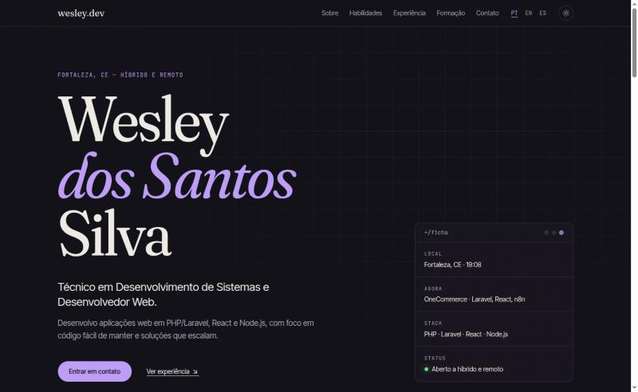
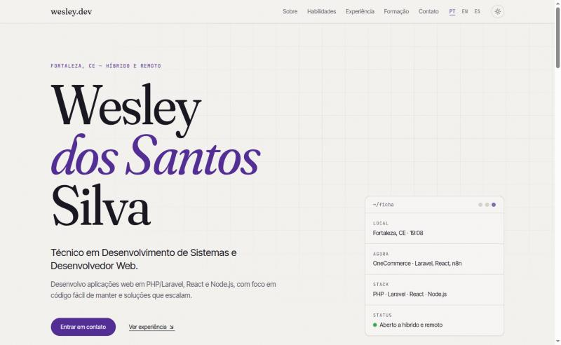
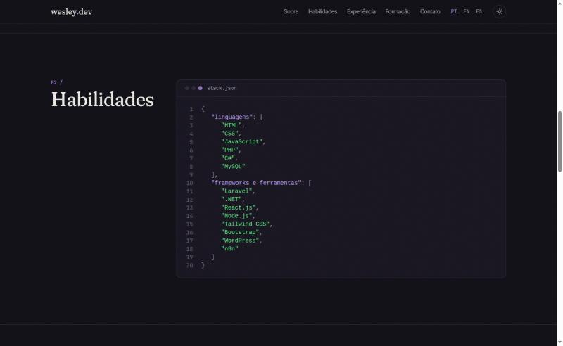
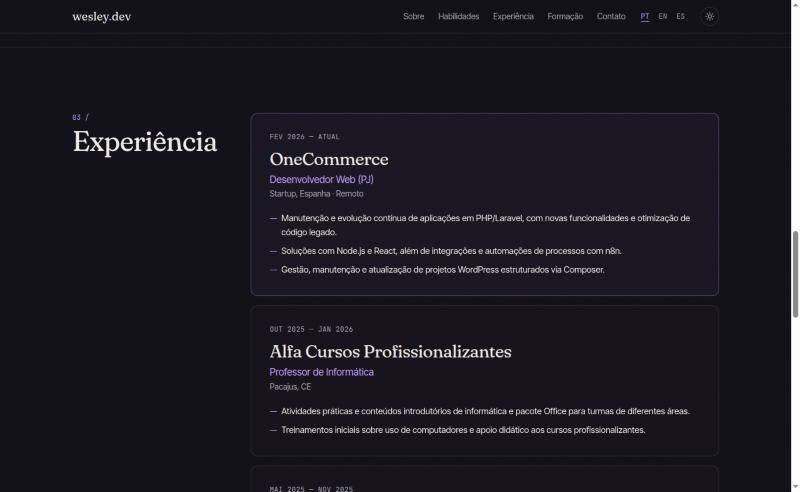

# Portfolio - Wesley Santos

[🇧🇷 Português](#-português) | [🇺🇸 English](#-english) | [🇪🇸 Español](#-español)

<p align="center">
  
  
</p>
<p align="center">
  
  
</p>

---

## 🇧🇷 Português

Repositório do meu portfólio pessoal, onde apresento minha experiência, habilidades e formação como Desenvolvedor Web. O site está disponível em português, inglês e espanhol.

### ✨ Destaques

*   Tema **escuro** (padrão) e **claro**, com a escolha salva no navegador
*   Hero com uma "ficha" que mostra a hora de Fortaleza em tempo real
*   Habilidades apresentadas como um arquivo `stack.json` em um editor
*   Seções numeradas com título fixo na lateral e animações suaves de entrada (respeitam `prefers-reduced-motion`)
*   Troca de idioma (PT / EN / ES) com detecção automática pelo navegador
*   Layout responsivo

### 🚀 Tecnologias

*   **Core**: React 18, TypeScript, Vite (SWC)
*   **Estilização**: Tailwind CSS, componentes base do shadcn/ui (Radix UI)
*   **Tipografia**: Fraunces (títulos), Inter Tight (texto) e JetBrains Mono (detalhes), via Google Fonts
*   **Internacionalização**: i18next, react-i18next, i18next-browser-languagedetector
*   **Ícones**: Lucide React
*   **Testes**: Vitest, Testing Library

### 📁 Estrutura

```
src/
├── components/portfolio/   # Navbar, Hero, About, Skills, Experience, Contact, Footer
├── i18n.ts                 # Textos em PT, EN e ES
├── index.css               # Tokens de cor (claro/escuro) e estilos globais
└── pages/Index.tsx         # Composição da página
```

Para atualizar textos ou experiências, edite `src/i18n.ts`. As cores ficam nas variáveis CSS de `src/index.css`.

### ⚙️ Como executar

1.  Clone o repositório:
    ```bash
    git clone https://github.com/Wesley085/Portfolio.git
    ```
2.  Instale as dependências:
    ```bash
    npm install
    ```
3.  Inicie o servidor de desenvolvimento (http://localhost:8080):
    ```bash
    npm run dev
    ```
4.  Para gerar a versão de produção:
    ```bash
    npm run build
    ```

---

## 🇺🇸 English

Repository of my personal portfolio, where I present my experience, skills and education as a Web Developer. The site is available in Portuguese, English and Spanish.

### ✨ Highlights

*   **Dark** (default) and **light** themes, with the choice saved in the browser
*   Hero with a "profile card" showing the live local time in Fortaleza
*   Skills presented as a `stack.json` file in an editor window
*   Numbered sections with a sticky side title and soft entrance animations (respecting `prefers-reduced-motion`)
*   Language switcher (PT / EN / ES) with automatic browser detection
*   Responsive layout

### 🚀 Tech Stack

*   **Core**: React 18, TypeScript, Vite (SWC)
*   **Styling**: Tailwind CSS, shadcn/ui base components (Radix UI)
*   **Typography**: Fraunces (headings), Inter Tight (body) and JetBrains Mono (details), via Google Fonts
*   **Internationalization**: i18next, react-i18next, i18next-browser-languagedetector
*   **Icons**: Lucide React
*   **Testing**: Vitest, Testing Library

### 📁 Structure

```
src/
├── components/portfolio/   # Navbar, Hero, About, Skills, Experience, Contact, Footer
├── i18n.ts                 # Copy in PT, EN and ES
├── index.css               # Color tokens (light/dark) and global styles
└── pages/Index.tsx         # Page composition
```

To update copy or experience, edit `src/i18n.ts`. Colors live in the CSS variables of `src/index.css`.

### ⚙️ How to run

1.  Clone the repository:
    ```bash
    git clone https://github.com/Wesley085/Portfolio.git
    ```
2.  Install dependencies:
    ```bash
    npm install
    ```
3.  Start the development server (http://localhost:8080):
    ```bash
    npm run dev
    ```
4.  Build for production:
    ```bash
    npm run build
    ```

---

## 🇪🇸 Español

Repositorio de mi portafolio personal, donde presento mi experiencia, habilidades y formación como Desarrollador Web. El sitio está disponible en portugués, inglés y español.

### ✨ Destacados

*   Tema **oscuro** (por defecto) y **claro**, con la elección guardada en el navegador
*   Hero con una "ficha" que muestra la hora de Fortaleza en tiempo real
*   Habilidades presentadas como un archivo `stack.json` en un editor
*   Secciones numeradas con título fijo lateral y animaciones suaves de entrada (respetan `prefers-reduced-motion`)
*   Cambio de idioma (PT / EN / ES) con detección automática del navegador
*   Diseño responsivo

### 🚀 Tecnologías

*   **Core**: React 18, TypeScript, Vite (SWC)
*   **Estilos**: Tailwind CSS, componentes base de shadcn/ui (Radix UI)
*   **Tipografía**: Fraunces (títulos), Inter Tight (texto) y JetBrains Mono (detalles), vía Google Fonts
*   **Internacionalización**: i18next, react-i18next, i18next-browser-languagedetector
*   **Iconos**: Lucide React
*   **Pruebas**: Vitest, Testing Library

### 📁 Estructura

```
src/
├── components/portfolio/   # Navbar, Hero, About, Skills, Experience, Contact, Footer
├── i18n.ts                 # Textos en PT, EN y ES
├── index.css               # Tokens de color (claro/oscuro) y estilos globales
└── pages/Index.tsx         # Composición de la página
```

Para actualizar textos o experiencia, edita `src/i18n.ts`. Los colores están en las variables CSS de `src/index.css`.

### ⚙️ Cómo ejecutar

1.  Clona el repositorio:
    ```bash
    git clone https://github.com/Wesley085/Portfolio.git
    ```
2.  Instala las dependencias:
    ```bash
    npm install
    ```
3.  Inicia el servidor de desarrollo (http://localhost:8080):
    ```bash
    npm run dev
    ```
4.  Genera la versión de producción:
    ```bash
    npm run build
    ```
